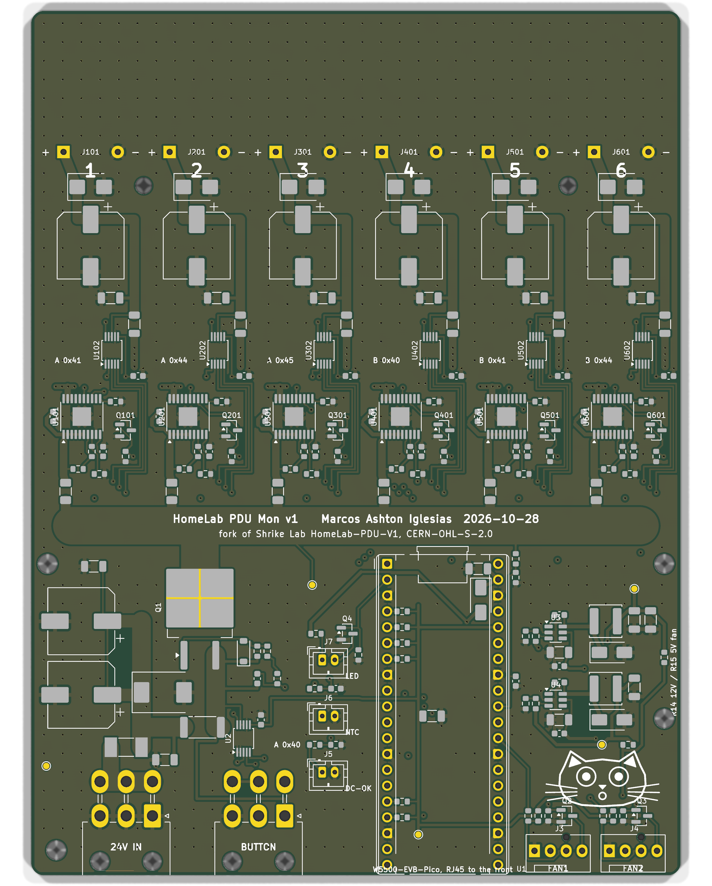

# HomeLab PDU Mon

A 1U 10" rack USB-C power unit for a mini PC homelab: one C14 mains inlet, a Mean Well HRP-300-24
inside, and 6 USB-C PD ports (65 W each), each with its own eFuse and power monitor, plus a
W5500-EVB-Pico that serves Prometheus metrics and can power-cycle any port.

Fork of [Shrike Lab HomeLab-PDU-V1](https://github.com/Shrike-Lab/HomeLab-PDU-V1)
(CERN-OHL-S-2.0). This fork is CERN-OHL-S-2.0 too: if you share or sell it, share the sources.

Marcos Ashton Iglesias, 2026-10-28.

## Layout

| Path | What |
|---|---|
| `SPEC.md` | Design spec: mechanical frame, power path, values, pinout, connectors |
| `pcb/gen.py` | Board generator: parts and nets tables, placement, autoroute, pours, DRC, Gerbers |
| `pcb/jlcpcb/make_jlc.py` | JLCPCB BOM and CPL from the board, with a live stock check |
| `enclosure/enclosure.py` | Sheet-metal enclosure (build123d): tray, lid, front, rear, assembly, marking DXF |
| `firmware/` | Rust/Embassy firmware: Prometheus metrics and per-port switching over Ethernet |
| `datasheets/` | Links to the HRP-300, TPS1663, INA237 and LMR16006 datasheets |

## Rebuild

```
cd pcb && python3 gen.py              # board, routing cached until placement or nets change
python3 jlcpcb/make_jlc.py            # BOM, CPL, parts_check.csv, assembly_note.txt
cd .. && .venv/bin/python enclosure/enclosure.py
```

`gen.py` needs KiCad 9 (pcbnew Python and kicad-cli) and Java for freerouting. The enclosure
script needs build123d, installed in `.venv` (`uv venv .venv && uv pip install -p .venv/bin/python build123d`).



## Ordering

- PCB and assembly, JLCPCB: `pcb/pdu_jlcpcb_gerbers.zip`, `pcb/jlcpcb/jlc_bom.csv`, `pcb/jlcpcb/jlc_cpl.csv`.
  4 layers (In1 solid GND), 1.6 mm, **2 oz outer copper**. Check part rotations in JLC's placement preview.
- Enclosure, JLCCNC sheet metal (5052 aluminium): `enclosure/*.step`, laser marking from
  `enclosure/marking.dxf`. See `enclosure/README.md` for finishes, hardware and the floor-screw decision.
- Bought separately: Mean Well HRP-300-24, 6 x XPM52C 65 W USB-C PD modules, W5500-EVB-Pico,
  C14 3-in-1 inlet (fuse + switch), 16 mm latching button, 40 mm 4-pin fan, RJ45 keystone coupler
  and short patch lead, Molex Mini-Fit Jr harnesses (see the original repo's harness drawings).

## Safety

Mains is only inside the Mean Well and on the inlet wiring. The case must be earthed: IEC earth
and HRP FG to the floor earth stud. Anodising insulates, so mask the earth stud area. Don't power
it with the lid off.
